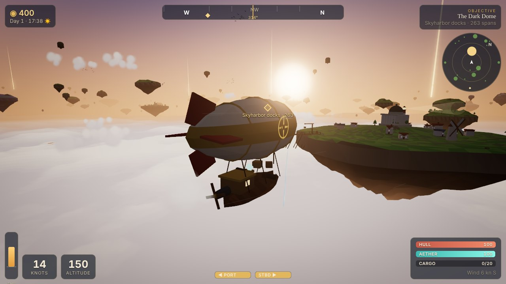
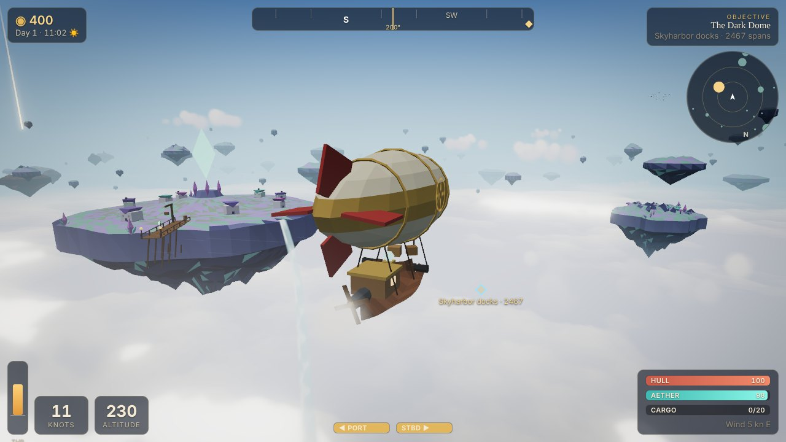
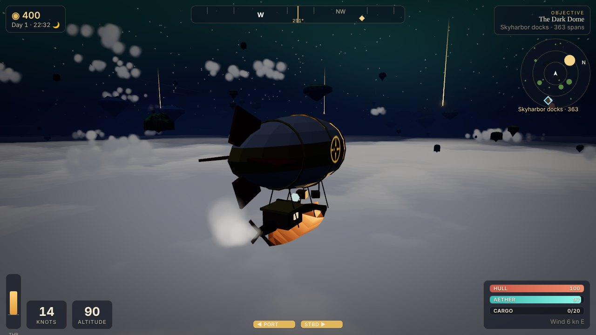
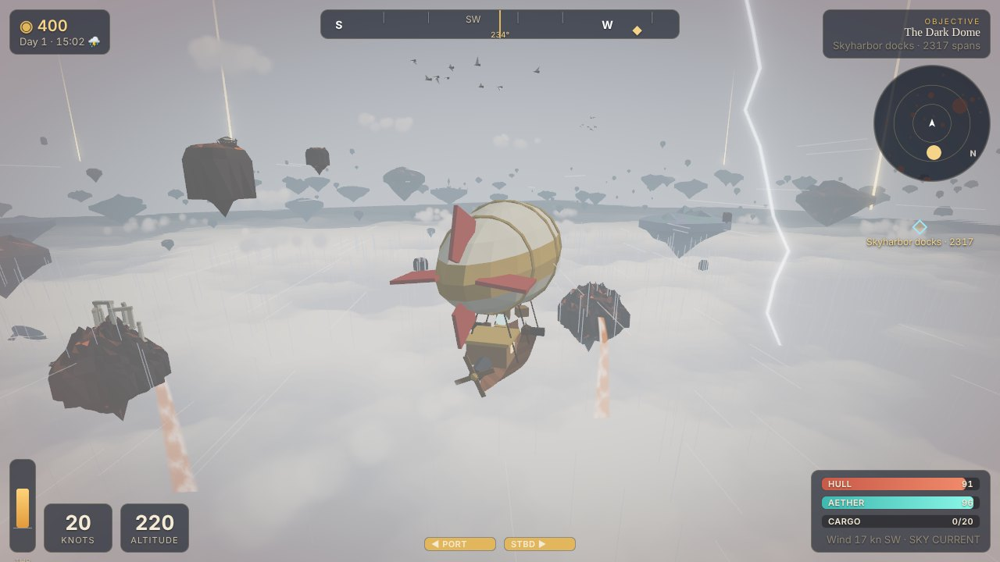
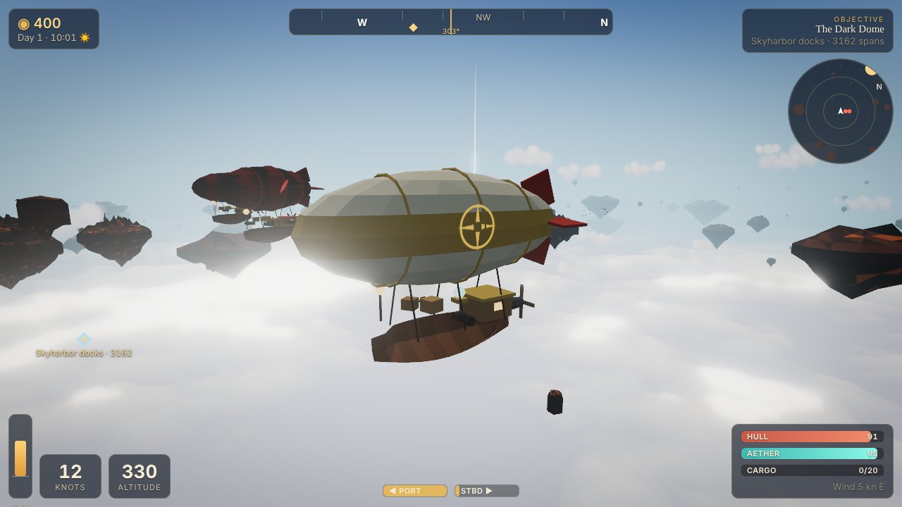
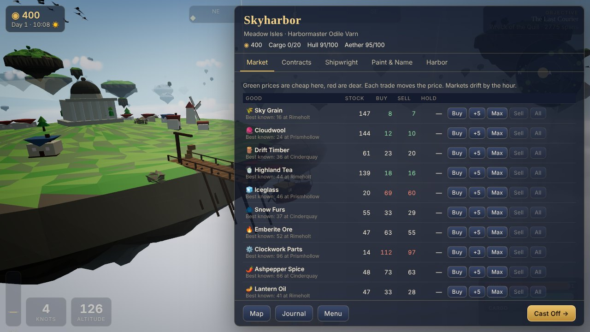
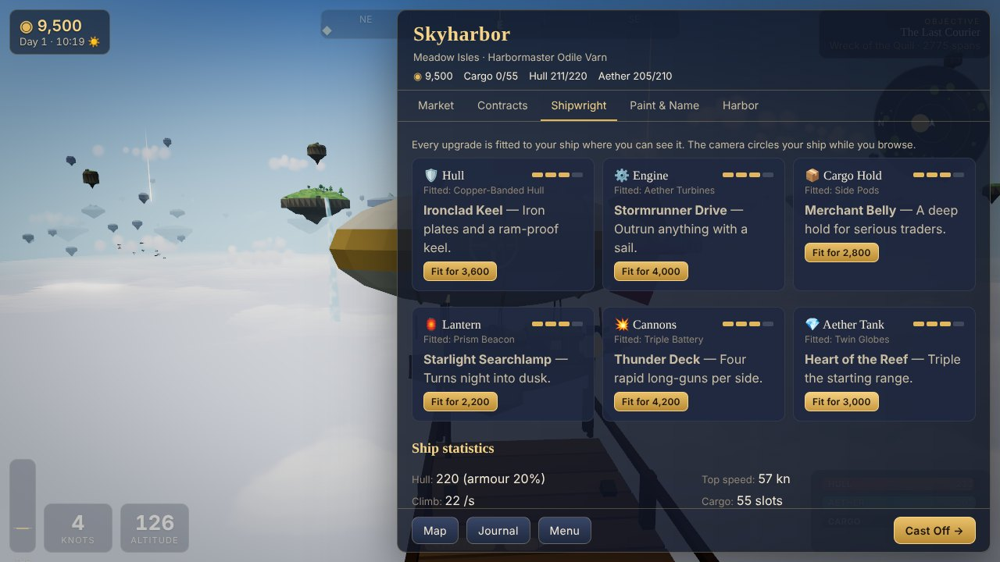
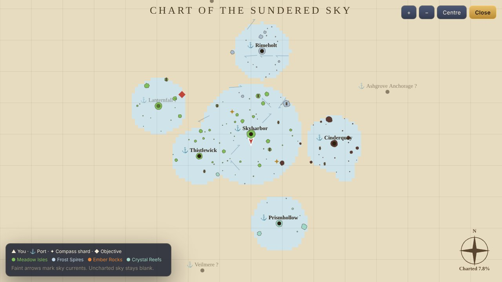
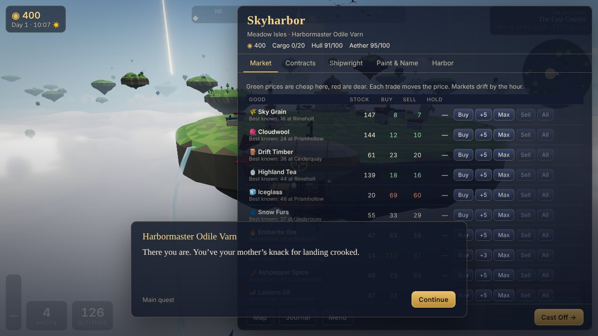

# Skyharbor

**An original 3D low-poly airship exploration and trading game that runs in your browser.**

Captain a small airship over an endless sea of clouds. Trade between floating ports, take
contracts, duel sky-pirates, chart the sky, and find out what happened to the vanished
Cartographers' Guild.

**Play:** https://zerochance1907.github.io/skyharbor/ (deployed from `main` by GitHub Pages)



| | |
| --- | --- |
|  |  |
|  |  |
|  |  |
|  |  |

Every model, texture, melody and sound is generated in code. The game ships no image, model or
audio files. See [CREDITS.md](CREDITS.md).

## Features

### World
- **Endless seeded sky.** Floating islands are generated per 700-span chunk from the world seed,
  streamed in around you and disposed behind you. Each island has a cheap far mesh at once and a
  detailed near mesh, with instanced trees, rocks and ruins, built under a per-frame time budget.
- **Four biomes, each with its own palette:** Meadow Isles (home), Frost Spires (north), Ember
  Rocks (east) and Crystal Reefs (south). Islands have noise terrain, cliff skirts, hanging
  undersides, ruins and waterfalls (or lava falls) that pour into the clouds.
- **Nine ports with docks**: the hand-designed home harbour of Skyharbor (Cartographers' Hall,
  lighthouse, windmill) and eight named ports, each with a landmark: Thistlewick, Lanternfall,
  Rimeholt, Pale Spindle, Cinderquay, Ashgrove Anchorage, Prismhollow and Veilmere.

### Flight
- Arcade-leaning airship physics: an engine telegraph (throttle), a rudder with inertia, ballast
  for altitude, sideslip drift and banking.
- **Wind** that veers over time, gusts, and **sky currents** (fast rivers of air that save fuel)
  shown as streaks in flight and arrows on the map.
- **Updrafts** along island cliffs (strongest over the Ember Rocks), and the crushing Undercloud
  below the cloud tops.
- Sphere-versus-island collision that uses the same height functions as the meshes. Hard
  impacts damage the hull.
- A smoothed third-person chase camera with mouse or stick orbit, speed-based FOV and shake.
- **Docking**: line up at a berth and press **F**, and the ship glides in and moors.

### Atmosphere
- A full day/night cycle (12 real minutes per day). The sky gradient follows the sun, and the
  sun, crescent moon, twinkling stars and faint aether ribbons are drawn in a shader.
- A volumetric-looking cloud sea made of stacked noise-shaded layers, plus instanced billboard
  cumulus that drift with the wind.
- Height fog that pools over the clouds.
- Weather: clear, calm, cloudy and storms. Storms bring rain and lightning that can strike and
  shove your ship. A permanent storm wall surrounds the finale.
- Ambient life: flocks of birds, and great sky-whales that swim in and out of the clouds and
  glow at night.
- Post-processing at the medium and high presets: bloom, plus a single grade and vignette pass
  that also shows damage flashes.

### Economy and progression
- **13 trade goods** with per-port stock, specialisation (producers sell cheap, consumers pay
  dear), scarcity pricing, a buy/sell spread, hourly drift, and random shortages and gluts.
- Cargo capacity, where timber and ore weigh double. **Aether fuel** limits your range. If you
  run dry, emergency sails give you a quarter of your power so you are never stranded.
- **Six upgrade tracks**: hull, engine, cargo, lantern, cannons and aether tank, each with four
  grades. **Every grade is visible on the ship model**: ribs, copper bands, iron plates and a
  ram; extra propellers and glowing turbines; nets, side pods and a belly hold; lamp, prism
  beacon and searchlight; more guns; aether globes that glow with remaining fuel.
- **Paint shop**: envelope, pattern, trim and hull colours, four patterns, five emblems and a
  ship name. Finishing the story unlocks Cartographer's Gold.

### Content
- **Contract boards** at every port that refresh daily: deliveries (with deadlines), salvage,
  escorts (a merchant ship flies with you and is ambushed on the way) and lost-ruin hunts (with
  a search circle on the map).
- **Main questline: The Vanished Cartographers.** Eight steps, from the dark dome of Skyharbor,
  through the wreck of the courier *Quill*, the Lamplighter of Lanternfall, the compass-rose
  shards, the Drowned Observatory, and a battle with the corsair flagship *Black Gannet*, to
  the eye of the storm at the **Hollow Meridian**.
- **12 compass-rose shards** marked by pillars of light. Each one charts the sky around it.
- **A fog-of-war world map**, revealed as you fly. A brighter lantern charts a wider area.
- **Sky pirates** (the Gullwake Corsairs) who chase you into a broadside position and fire when
  you are abeam. They flee when crippled and give up near ports. Sink them for floating loot, or
  upgrade your engine and outrun them.

### UI and controls
- HUD: speed, altitude, compass tape with an objective bearing, radar, engine telegraph, hull,
  aether and cargo bars, wind and current readout, gun reload bars, dock prompt, and an
  objective marker in the world.
- Screens: port menus (market, contracts, shipwright, paint, harbour), world map, journal
  (quest, contracts, logbook, atlas and records), settings, pause menu and save manager.
- **Keyboard and mouse, gamepad (standard mapping), and touch controls** with a virtual stick
  and buttons on phones.
- **Settings**: quality preset (low, medium, high), master, music and effects volume, invert Y,
  look sensitivity, FPS counter, touch controls, and **key remapping**.

### Audio
Everything is synthesised with WebAudio:
- **An adaptive generative soundtrack** with day, night, port, storm, combat and finale moods.
  Pads, plucked arpeggios through a delay, FM bells, bass and drums follow mode-based chord
  progressions.
- Engine hum and propeller chop that follow the throttle, wind that rises with speed, altitude
  and storms, rain, and harbour ambience (lapping water, bells and gulls).
- Whale song when a sky-whale swims near.
- Cannons, hits, explosions, delayed thunder, coins, pickups and fanfares.

### Saves
- An autosave every minute and on docking, three manual slots, a Continue button on the title
  screen, and JSON **export and import**.
- Versioned, validated save files (corrupt or foreign files are rejected with a clear message).
  The fog of war is stored as a compact bitset.

## Controls

| Action | Keyboard | Gamepad | Touch |
| --- | --- | --- | --- |
| Throttle up / down | W / S (or ↑ ↓) | Left stick ↕ | Stick ↕ |
| Rudder left / right | A / D (or ← →) | Left stick ↔ | Stick ↔ |
| Climb / descend | Space / C | RT / LT | ▲ / ▼ |
| Aether boost | Shift | B | ⚡ |
| Fire port / starboard broadside | Q / E | LB / RB | ◀ / ▶ |
| Dock / interact | F | A | ⚓ |
| World map | M | Back | 🗺 |
| Journal | J | Y | |
| Pause | Esc | Start | ☰ |
| Look around | Drag the mouse, wheel to zoom | Right stick | Drag on the screen |

All keys can be remapped in **Settings**.

**Tips:** Green prices are cheap and red prices are dear, and the market shows the best selling price
among the ports you have discovered. Ride sky currents to save aether. Climb high to spot the golden pillars
of compass shards. Pirates rarely follow you into port.

## Development

Requires Node.js 22 or newer and npm 11. Node 24 ships npm 11. npm 10 hits a known
peer-resolution bug on this dependency tree.

```bash
npm ci
```

```bash
npm run dev
```

```bash
npm run typecheck
```

```bash
npm test
```

```bash
npm run build
```

```bash
npm run e2e
```

The end-to-end test runs against `vite preview` (`npm run build` first) in Chromium with
SwiftShader WebGL. It boots the game, starts a voyage, flies with real key presses, docks with
**F**, buys and sells at the market, and fails on any console error.

Exact versions are pinned: Three.js 0.186.0, Vite 8.3.4, TypeScript 6.0.3, Vitest 4.1.12 and
Playwright 1.63.0.

CI (`.github/workflows/ci.yml`) runs the typecheck, unit tests, build and e2e test.
`.github/workflows/pages.yml` deploys `dist/` to GitHub Pages on every push to `main`. The Vite
`base` is `/skyharbor/`.

## Architecture

```
src/
  core/      rng (mulberry32, hashing), simplex noise + fbm, math, event emitter
  sim/       pure, deterministic game rules - no three.js, fully unit-tested
    world.ts       chunked island generation, biomes, surface heights, collision, updrafts
    flight.ts      airship flight model (throttle, rudder, lift, wind, collision response)
    wind.ts        prevailing wind, gusts, sky currents
    weather.ts     weather state machine and the storm wall
    economy.ts     markets, pricing, trading, drift
    goods.ts       trade goods      ports.ts   ports, berths, landmarks
    upgrades.ts    upgrade tracks and derived ship stats
    contracts.ts   contract boards and resolution
    story.ts       main questline, compass shards
    combat.ts      pirate and merchant AI, broadsides, ballistics
    fog.ts         fog-of-war bitset       state.ts  GameState + new game
    save.ts        versioned serialisation, validation, slots
  render/    three.js presentation
    renderer.ts    WebGL renderer, quality presets, post-processing
    islands.ts     island meshes, waterfalls, chunk streaming + LOD under a time budget
    structures.ts  ports, docks, landmarks (merged into a few draw calls per site)
    ship.ts        procedural airship with visible upgrades and paint
    sky.ts clouds.ts heightFog.ts  sky dome, cloud sea, height fog
    fx.ts life.ts camera.ts        particles, lightning, rain, beacons, birds, whales, chase cam
  audio/     procedural WebAudio music and SFX
  input/     keyboard/mouse/gamepad/touch, settings and key bindings
  ui/        DOM HUD, menus, map (canvas), styles
  game.ts    the orchestrator: frame loop, fixed-step simulation, glue between layers
tests/
  unit/      Vitest: world determinism, economy, upgrades, quests, saves, flight, combat
  e2e/       Playwright smoke test
```

**Design notes**

- **Simulation and presentation are split.** Everything under `src/sim` is pure TypeScript
  driven by explicit seeds and RNG state, so the same seed always gives the same world, markets
  and contract boards, and the rules can be tested headless. The renderer reads the same
  functions, so collision matches what you see.
- **Fixed-step simulation** runs at 60 Hz with an accumulator. Rendering runs at display rate.
- **Performance**: flat-shaded geometry with baked vertex colours, merged into one draw call
  per model; instanced decorations, cloud puffs, birds and cannonballs; chunk disposal; a time
  budget for mesh building; a fixed light count, so shaders never recompile; a 30 Hz DOM HUD;
  and quality presets. At the medium preset a typical view is about 110–150 draw calls, and the
  CPU-side simulation and scene update take about 1–2 ms per frame. The **low** preset (the
  default on phones) lowers resolution, view distance, cloud layers and particles, and turns
  off post-processing.
- **The `window.__skyharbor` debug hook** exposes state and a few helpers (teleport, approach a
  port) for the e2e test and for debugging.

## License

[MIT](LICENSE) © zerochance1907
